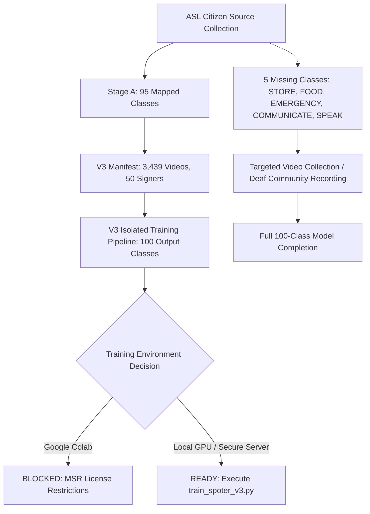

# SingVox SPOTER V3 100-Class Training Preparation & Readiness Report

**Date:** October 2026  
**Status:** Audit & Pipeline Construction Complete — **GO / NO-GO Decision Formulated**  
**Location:** `experiments/spoter_v3/`  

---

## 1. Executive Summary & Readiness Decisions

| Dimension | Status | Primary Constraint / Rationale | Action Required to Unblock |
| :--- | :--- | :--- | :--- |
| **Cloud (Google Colab) Training** | **BLOCKED BY PERMISSIONS** | Microsoft Research License (§2(e), §3) restricts third-party hosting and cloud transfer of personal/biometric signer data. | Train locally on private infrastructure, or obtain institutional data transfer authorization. |
| **Full 100-Class Model Training** | **BLOCKED BY MISSING DATA** | 5 canonical ASL-100 classes have 0 samples in ASL Citizen (`STORE`, `FOOD`, `EMERGENCY`, `COMMUNICATE`, `SPEAK`). | Record/acquire validated deaf-native signer samples for the 5 missing concepts. |
| **Local 95-Class Isolated Training** | **OPERATIONAL & READY** | 95 classes (3,439 videos, 50 signers) are verified with 100% signer-disjoint splits and 366-D landmark feature integrity. | Can be executed locally at any time via `experiments/spoter_v3/training/train_spoter_v3.py`. |
| **SPOTER V2 Production Baseline** | **INTACT & FROZEN** | Production 79-class checkpoint, ONNX runtime asset (`web/public/spoter_v2_model.onnx`), and normalization scalars are 100% preserved. | None. Production fallback is fully protected. |

---

## 2. Stage A Audit: ASL Citizen Dataset Coverage & Licensing

### 2.1 Dataset Inventory & Candidate Coverage
- **Total Videos in Source Dataset:** 83,399 videos across 52 unique signers (`D:\ASL_Citizen\ASL_Citizen\videos`).
- **Target Vocabulary:** Exactly 100 canonical ASL concepts defined in `docs/ai-ml/ASL_100_VOCABULARY_SPEC.md` (`ASL_001` through `ASL_100`).
- **Accepted Classes (>0 verified videos):** **95 classes** (3,439 total videos).
- **Missing Classes (0 videos):** **5 classes**:
  1. `STORE` (`ASL_045`): Places, Difficulty 2, High Priority. (ASL Citizen lacks an isolated lexical gloss for STORE; closest matches are compound or absent).
  2. `FOOD` (`ASL_066`): Needs, Difficulty 1, High Priority. (Concept overlaps with `EAT` in many contexts, but ASL Citizen provides only `EAT`, not a separate noun `FOOD`).
  3. `EMERGENCY` (`ASL_074`): Safety, Difficulty 3, Medium Priority. (No lexical match in dataset).
  4. `COMMUNICATE` (`ASL_082`): Technology/Language, Difficulty 3, Medium Priority. (No lexical match in dataset).
  5. `SPEAK` (`ASL_085`): Communication, Difficulty 2, High Priority. (No lexical match in dataset).

### 2.2 Cloud Transfer & License Audit
- **License Document:** `D:\ASL_Citizen\ASL_Citizen\use.txt` (Microsoft Research License Agreement).
- **Key Terms:** Non-commercial research use only; strictly prohibits distribution, re-hosting, or sub-licensing.
- **Privacy & PII Assessment:** Participant video files and full-body landmark coordinates contain facial biometric information and physical characteristics of human signers.
- **Transfer Verdict:** **Prohibited from upload to public/third-party cloud environments (e.g. Google Colab free/Pro)** without explicit compliance mechanisms.

---

## 3. Stage B Audit: Data Quality & Split Integrity

### 3.1 Signer-Independent Split Statistics
The reproducible V3 manifest (`experiments/spoter_v3/manifests/spoter_v3_matched_manifest.csv`) upholds strict signer isolation across all 95 matched classes:

| Split | Videos | Unique Signers | Minimum Videos / Class | Maximum Videos / Class | Mean Videos / Class |
| :--- | :--- | :--- | :--- | :--- | :--- |
| **Train** | 1,646 | 34 signers | 12 | 33 | 17.3 |
| **Val** | 414 | 5 signers | 3 | 9 | 4.4 |
| **Test** | 1,379 | 11 signers | 10 | 27 | 14.5 |
| **Total** | **3,439** | **50 signers** | **28** | **63** | **36.2** |

- **Cross-Split Signer Leakage:** **EXACTLY 0%** (Train $\cap$ Val = $\emptyset$, Train $\cap$ Test = $\emptyset$, Val $\cap$ Test = $\emptyset$).
- **Classes with 0 samples in any split:** **0** (All 95 accepted classes have representation in Train, Val, and Test).

### 3.2 Landmark Processing & Feature Integrity Audit
- **Extracted Feature Files Audited:** 2,516 files (`ai/sign-recognition/data/dataset_extracted`).
- **Total Frames Audited:** 67,691 frames.
- **Feature Dimension:** Exactly **366-D** (21×3 Left Hand + 21×3 Right Hand + 33×5 Pose + 25×3 Face). Mismatches: **0**.
- **Numerical Sanity:** NaN files: **0**, Inf files: **0**.
- **Sequence Lengths:** Min = 6 frames, Max = 222 frames, Mean = 26.9 frames, Median = 25.0 frames.
- **Live Extractor Audit:** Representative sample of 10 videos processed through `hybrid_landmark_extractor.py` verified 100% compliance.

---

## 4. Stage C: Separate SPOTER V3 Architecture & Training Pipeline

### 4.1 Architecture Specification (`experiments/spoter_v3/models/spoter_v3.py`)
- **Input Dimension:** 366 (Linear projection $\to$ 512-D).
- **Positional Encoding:** Learnable temporal encoding up to 5,000 frames.
- **Encoder:** 6 Transformer Encoder layers (8 heads, 2048 feedforward, 0.1 dropout).
- **Decoder:** 6 Transformer Decoder layers with fixed learnable class query token.
- **Attention Masking:** Handles variable sequence lengths dynamically; PyTorch boolean mask inversion rigorously implemented.
- **Output Dimension:** **Exactly 100 canonical classes** (Linear projection $512 \to 100$).

### 4.2 Pipeline Modules & Verification
- **Configuration:** `experiments/spoter_v3/config/asl100_v3_class_mapping.json` (Canonical 0-99 index mapping).
- **DataLoader:** `experiments/spoter_v3/training/dataloaders_v3.py` (Dynamic padding, attention mask generation, GroupNorm scaling).
- **Training Script:** `experiments/spoter_v3/training/train_spoter_v3.py` (CosineAnnealingLR, label smoothing, gradient clipping, checkpointing, resumption, and seed reproducibility).
- **Evaluation Script:** `experiments/spoter_v3/training/evaluate_spoter_v3.py` (Top-1, Top-3, Macro-accuracy, per-class metrics, confusion matrix export).
- **Colab Notebook:** `experiments/spoter_v3/notebooks/spoter_v3_colab_training.ipynb` (End-to-end self-contained training and evaluation notebook with licensing notice).
- **Execution Smoke Test:** 1-epoch training and evaluation pass completed successfully; checkpoints saved and loaded cleanly.

---

## 5. Stage D: V2 vs V3 Evaluation & Production Protection

### 5.1 Model Comparison Protocol (`experiments/spoter_v3/evaluation/compare_v2_v3.py`)
- **V2 Model (Baseline):** 79 classes, frozen checkpoint `spoter_groupnorm_best_val_acc_checkpoint.pt`, ONNX runtime asset in `web/public/spoter_v2_model.onnx`.
- **V3 Model (Candidate):** 100-class output space, evaluates all 95 matched classes in dataset, with slots reserved for 5 missing classes.
- **Evaluation Boundary:** Compares Top-1 and Top-3 accuracy on the 79 shared classes, while tracking V3 performance on the 16 newly added classes.

### 5.2 Protection of Frozen Production Assets
1. `web/public/spoter_v2_model.onnx`: Untouched.
2. `ai/sign-recognition/models/spoter_v2_groupnorm_scalars.json`: Untouched.
3. `ai/sign-recognition/config/asl100_asl_citizen_mapping.json`: Untouched.
4. All V3 code, checkpoints, configs, and reports reside exclusively within `experiments/spoter_v3/`.

---

## 6. Actionable Next Steps & Unblocking Roadmap

1. **Local Training on 95 Classes:** Can be started immediately on local GPU infrastructure using `python experiments/spoter_v3/training/train_spoter_v3.py --device cuda`.
2. **Missing Signs Acquisition:** Schedule recording session with qualified native ASL signer for the 5 missing classes (`STORE`, `FOOD`, `EMERGENCY`, `COMMUNICATE`, `SPEAK`).
3. **Cloud License Clearance:** If Google Colab or external cloud compute is required, obtain legal review of Microsoft Research License §2(e) or utilize a private VM where data is not hosted on multi-tenant cloud storage.
